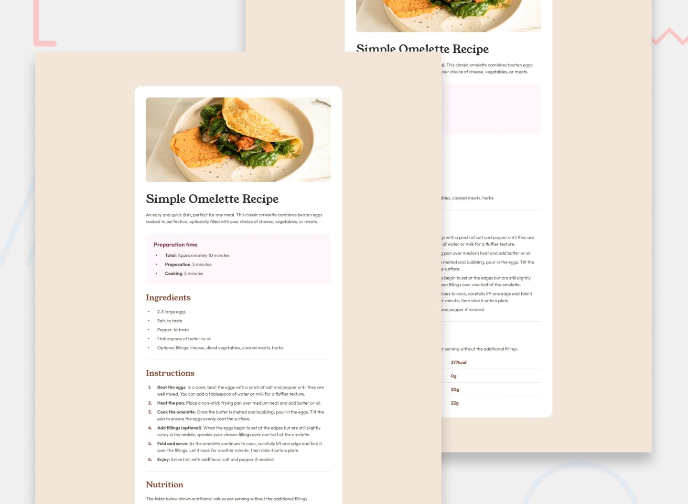
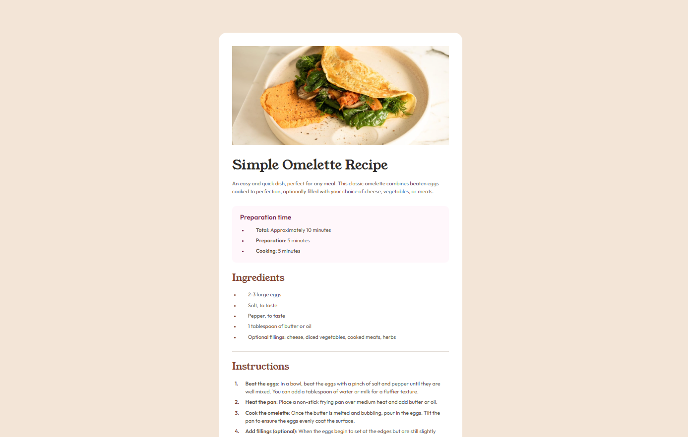
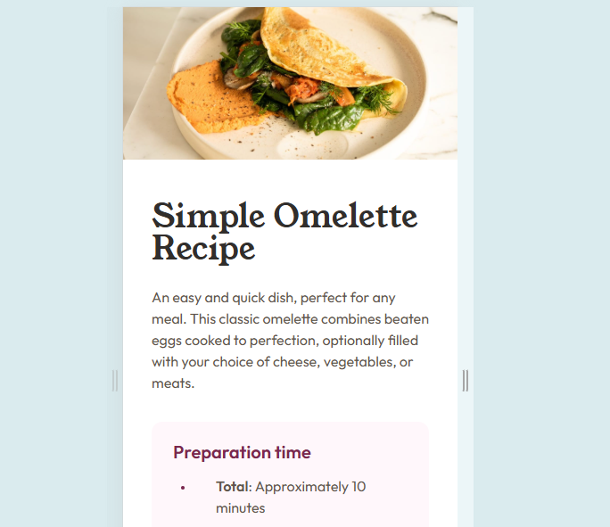

# Frontend Mentor - Recipe page solution

This is a solution to the [Recipe page challenge on Frontend Mentor](https://www.frontendmentor.io/challenges/recipe-page-KiTsR8QQKm). Frontend Mentor challenges help you improve your coding skills by building realistic projects. 

## Table of contents

- [Overview](#overview)
  - [Screenshot](#screenshot)
  - [Links](#links)
- [My process](#my-process)
  - [Built with](#built-with)
  - [What I learned](#what-i-learned)
  - [Continued development](#continued-development)
  - [AI Collaboration](#ai-collaboration)
- [Author](#author)

## Overview

### Screenshot

#### Solution preview
Final solution from Frontend Mentor, how it should seems.



#### Desktop preview

Prepared view of component after developed on desktop resolution.



#### Mobile preview

Prepared view of component after developed on mobile (375px) resolution.



### Links

- Solution URL: [Repository URL](https://github.com/DavydIkkes/fm-recipe-page)
- Live Site URL: [GitHub Pages URL](https://davydikkes.github.io/fm-recipe-page/)

## My process

### Built with

- Semantic HTML5 markup
- CSS custom variables list, all values that can be changed used as a variable
- Custom list marker types 
- Flexbox
- CSS Grid
- Mobile-first workflow
- Media queries for other resolutions

### What I learned

I learned how to organize the structure of a CSS document—adding sections and moving all variable values ​​to `:root`—as well as how to work more effectively with `@font-face` and customize list markers and the overall appearance of lists. I also improved my approach to structuring semantic HTML.

To see how you can add code snippets, see below.

Table definition snippet:
```html
 <table>
    <tbody>
        <tr>
            <th scope="row">Calories</th>
            <td>277kcal</td>
        </tr>
```

Font size presets with `rem` values:
```css
/* Font sizes variables */
    --font-size-preset-1: 2.5rem;
    --font-size-preset-1-mobile: 2.25rem;
    --font-size-preset-2: 1.75rem;
    --font-size-preset-3: 1.25rem;
    --font-size-preset-4: 1rem;
```

Usage variables for spacing:
```css
.recipe__content {
    padding: var(--spacing-500) var(--spacing-400);
    display: flex;
    flex-direction: column;
    gap: var(--spacing-400);
}
```

### Continued development

Refactor this code to better structer and BEM methodology usage insted of general selectors in CSS and HTML.

### AI Collaboration

AI helps me to fix some small errors that I had during the development. Fix some issues with tables borders, list markers, and image layout.
I use default opportunities of GitHub Copilot from VS Code chat without any inline suggestions.

## Author

- Frontend Mentor - [@DavydIkkes](https://www.frontendmentor.io/profile/DavydIkkes)
